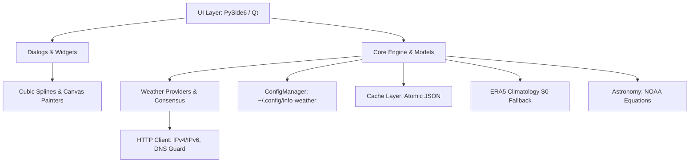
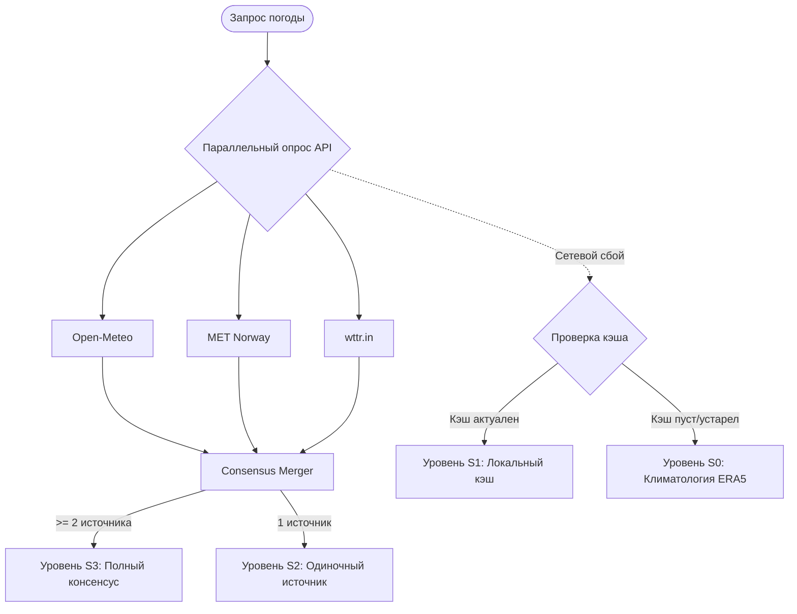

# Архитектура проекта info-weather 📐

Документ описывает программную архитектуру, ключевые подсистемы, модель данных и принципы построения приложения **info-weather**.

---

## 1. Обзор архитектуры

Приложение построено по модульному принципу с разделением ответственности:

### Структура пакетов
- [`core/`](../core/): базовые сервисы (конфигурация, кэширование, астрономия, геомагнитная активность, единицы измерения, i18n-локализация, HTTP-клиент, автозапуск, системные уведомления).
- [`models/`](../models/): типизированные структуры данных метеорологических наблюдений и прогнозов.
- [`providers/`](../providers/): клиенты погодных API и алгоритм многопровайдерного консенсуса.
- [`ui/`](../ui/): главное безрамочное окно виджета ([`widget_window.py`](../ui/widget_window.py)), менеджер стилей, вспомогательные функции.
  - [`ui/blocks/`](../ui/blocks/): независимые подключаемые блоки виджета (шапка, периоды суток, дни, роза ветров, астрономия, метрики).
  - [`ui/dialogs/`](../ui/dialogs/): диалоговые окна (подробный прогноз с 3 экранами, настройки, поиск городов).
  - [`ui/effects/`](../ui/effects/): процедурные микроанимации погодных эффектов.
- [`data/`](../data/): встроенные статические данные (ERA5 климатические нормы, WMO-коды).
- [`assets/`](../assets/): векторные и растровые ресурсы (собственные иконки, Meteocons, Weather Icons, фоны городов).

---

## 2. Модель данных (`models/weather.py`)

Данные нормализуются в строгие структуры данных `dataclass`:
- **`CurrentConditions`**: температура, ощущаемая температура, влажность, давление (гПа и мм рт. ст.), скорость/порывы/направление ветра, точка росы, погодный код WMO, флаг дня/ночи.
- **`HourlyForecast`**: почасовой срез на 24–48 часов (температура, осадки, вероятность осадков, давление, вектор ветра, погодный код).
- **`DailyForecast`**: суточный прогноз (максимальная и минимальная температура, код явления, вероятность осадков, восход/закат).
- **`DayDetailedForecast`**: расширенная суточная статистика для розы ветров и климатического анализа.
- **`WeatherForecastData`**: агрегированный контейнер данных для города, содержащий метаданные локации (широта, долгота, смещение UTC), текущие условия и прогнозы.

---

## 3. Многопровайдерный консенсус (S3 → S2 → S1 → S0)

Система сбора данных реализует четыре уровня отказоустойчивости:

### Алгоритм консенсуса:
1. **Непрерывные физические величины** (температура, точка росы, влажность, давление, скорость ветра):
   - Вычисляется статистическая **медиана** среди ответивших провайдеров, исключая выбросы отдельных сервисов.
2. **Вектор ветра** (направление в градусах):
   - Вычисляется круговая средняя (circular mean) через тригонометрические проекции ($\sin \theta, \cos \theta$).
3. **Погодные явления и код WMO**:
   - Применяется приоритет осадков: если хотя бы один авторитетный источник фиксирует осадки (дождь, гроза, снегопад), явление сохраняется с мажоритарным выбором интенсивности.

---

## 4. Отрисовка графиков и сплайнов (Detailed Forecast Dialog)

Диалог [`DetailedForecastDialogQt`](../ui/dialogs/detailed_forecast_dialog.py) содержит процедурную векторную отрисовку через `QPainter`:

### Сплайны Безье температурного графика
В [`HourlySplineChartWidget`](../ui/dialogs/detailed_forecast_dialog.py) сглаживание точек выполняется с помощью **кубических кривых Безье** (`cubicTo`):
- Для каждой пары соседних точек $P_i$ и $P_{i+1}$ контрольные точки рассчитываются на основе наклона хорды:
  $$C_1 = \left(x_i + \frac{\Delta x}{3}, y_i + \frac{m_i \Delta x}{3}\right), \quad C_2 = \left(x_{i+1} - \frac{\Delta x}{3}, y_{i+1} - \frac{m_{i+1} \Delta x}{3}\right)$$
- Применяется ограничение (clamping) для предотвращения овершутов (ложных локальных экстремумов между близкими температурами).
- **Многодневный режим:** параллельно строятся две кривые (дневная макс. и ночная мин.). Область между кривыми заполняется градиентным полигоном `QPainterPath` с плавной прозрачностью.

### Роза ветров (Wind Rose)
В [`FullWindRoseWidget`](../ui/dialogs/wind_rose_widget.py):
- Расчет 16 румбов (секторов по $22.5^\circ$).
- Радиальное накопление долей времени по диапазонам Бофорта через составные дуговые сегменты (`drawPie` / `addPolygon`).
- Отрисовка концентрических колец повторяемости (5%, 10%, 15%, 20%, 25%) и центрального круга штиля.

---

## 5. Система тем и адаптивного оформления

- **Астрономический расчет (`auto_solar`):** модуль [`core/astronomy.py`](../core/astronomy.py) рассчитывает солнечное склонение, истинный полдень и моменты восхода/заката для точных координат города по формулам NOAA Solar Calculator.
- **Векторная перекраска иконок:** модуль [`ui/utils.py`](../ui/utils.py) адаптирует SVG-пиктограммы под цветовую гамму текущей темы (инверсия монохромных символов, динамические градиенты для светлой и темной темы).
- **Живые эффекты погоды:** процедурная анимация в [`ui/effects/weather_effects.py`](../ui/effects/weather_effects.py) с контролем частоты кадров и переходом в спящий режим при скрытии окна.

---

## 6. Сетевой уровень и безопасность

- Защита от зависания DNS: отдельный поток разрешения доменных имен с таймаутом `dns_timeout_seconds`.
- IPv4 Fallback: приоритет IPv4-стека предотвращает задержки при некорректно настроенном провайдерском IPv6.
- Атомарное сохранение кэша: запись во временный файл с последующим атомарным `os.replace` защищает кэш от повреждения при внезапном завершении питания.
