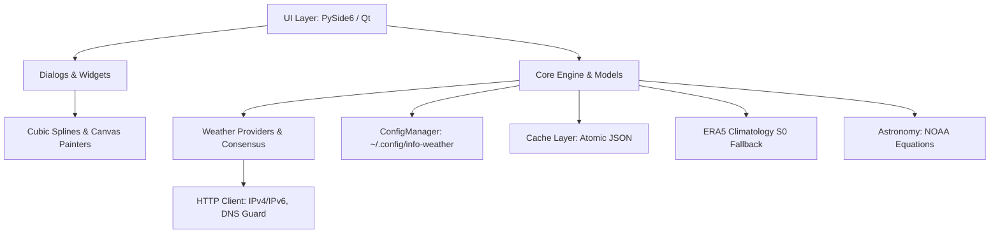
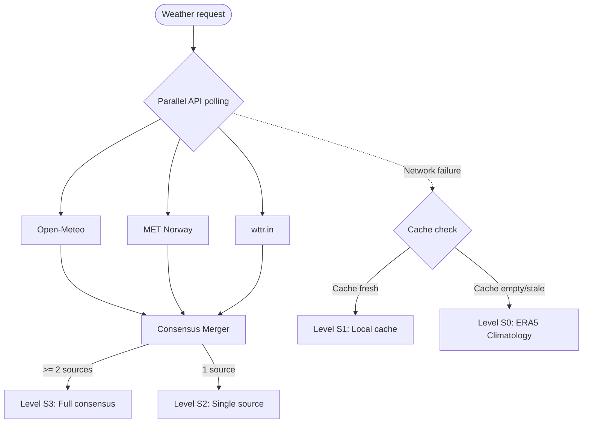

# info-weather Project Architecture 📐

This document describes the software architecture, key subsystems, data model and design principles of the **info-weather** application.

---

## 1. Architecture Overview

The application follows a modular design with separation of concerns:

### Package Structure
- [`core/`](../core/): base services (configuration, caching, astronomy, geomagnetic activity, units, i18n localization, HTTP client, autostart, system notifications).
- [`models/`](../models/): typed data structures for meteorological observations and forecasts.
- [`providers/`](../providers/): weather API clients and the multi-provider consensus algorithm.
- [`ui/`](../ui/): the main frameless widget window ([`widget_window.py`](../ui/widget_window.py)), the style manager, and helper functions.
  - [`ui/blocks/`](../ui/blocks/): independent pluggable widget blocks (header, day periods, days, wind rose, astronomy, metrics).
  - [`ui/dialogs/`](../ui/dialogs/): dialogs (detailed forecast with 3 screens, settings, city search).
  - [`ui/effects/`](../ui/effects/): procedural micro-animations of weather effects.
- [`data/`](../data/): bundled static data (ERA5 climate normals, WMO codes).
- [`assets/`](../assets/): vector and raster resources (own icons, Meteocons, Weather Icons, city backgrounds).

---

## 2. Data Model (`models/weather.py`)

Data is normalized into strict `dataclass` structures:
- **`CurrentConditions`**: temperature, feels-like temperature, humidity, pressure (hPa and mmHg), wind speed/gusts/direction, dew point, WMO weather code, day/night flag.
- **`HourlyForecast`**: an hourly slice for 24–48 hours (temperature, precipitation, precipitation probability, pressure, wind vector, weather code).
- **`DailyForecast`**: daily forecast (max and min temperature, phenomenon code, precipitation probability, sunrise/sunset).
- **`DayDetailedForecast`**: extended daily statistics for the wind rose and climate analysis.
- **`WeatherForecastData`**: an aggregated data container for a city, holding location metadata (latitude, longitude, UTC offset), current conditions and forecasts.

---

## 3. Multi-Provider Consensus (S3 → S2 → S1 → S0)

The data collection system implements four resilience levels:

### Consensus Algorithm:
1. **Continuous physical quantities** (temperature, dew point, humidity, pressure, wind speed):
   - A statistical **median** is computed among the responding providers, excluding outliers of individual services.
2. **Wind vector** (direction in degrees):
   - A circular mean is computed via trigonometric projections ($\sin \theta, \cos \theta$).
3. **Weather phenomena and the WMO code**:
   - A precipitation priority is applied: if at least one authoritative source reports precipitation (rain, thunderstorm, snowfall), the phenomenon is kept with a majority vote for intensity.

---

## 4. Chart and Spline Rendering (Detailed Forecast Dialog)

The [`DetailedForecastDialogQt`](../ui/dialogs/detailed_forecast_dialog.py) dialog performs procedural vector rendering via `QPainter`:

### Bézier Splines of the Temperature Chart
In [`HourlySplineChartWidget`](../ui/dialogs/detailed_forecast_dialog.py), point smoothing is done with **cubic Bézier curves** (`cubicTo`):
- For each pair of neighboring points $P_i$ and $P_{i+1}$, the control points are computed from the chord slope:
  $$C_1 = \left(x_i + \frac{\Delta x}{3}, y_i + \frac{m_i \Delta x}{3}\right), \quad C_2 = \left(x_{i+1} - \frac{\Delta x}{3}, y_{i+1} - \frac{m_{i+1} \Delta x}{3}\right)$$
- Clamping is applied to prevent overshoots (false local extrema between close temperatures).
- **Multi-day mode:** two curves are built in parallel (day max and night min). The area between the curves is filled with a gradient polygon `QPainterPath` with smooth transparency.

### Wind Rose
In [`FullWindRoseWidget`](../ui/dialogs/wind_rose_widget.py):
- Calculation of 16 points (22.5° sectors).
- Radial accumulation of time shares by Beaufort ranges via compound arc segments (`drawPie` / `addPolygon`).
- Rendering of concentric frequency rings (5%, 10%, 15%, 20%, 25%) and a central calm circle.

---

## 5. Theme System and Adaptive Appearance

- **Astronomical calculation (`auto_solar`):** the [`core/astronomy.py`](../core/astronomy.py) module calculates the solar declination, true noon and the sunrise/sunset moments for the exact city coordinates using NOAA Solar Calculator formulas.
- **Vector icon recoloring:** the [`ui/utils.py`](../ui/utils.py) module adapts SVG pictograms to the current theme palette (inversion of monochrome glyphs, dynamic gradients for light and dark themes).
- **Live weather effects:** procedural animation in [`ui/effects/weather_effects.py`](../ui/effects/weather_effects.py) with frame-rate control and sleep mode when the window is hidden.

---

## 6. Network Layer and Security

- DNS hang protection: a dedicated thread resolves domain names with the `dns_timeout_seconds` timeout.
- IPv4 fallback: IPv4-stack preference prevents delays caused by a misconfigured provider IPv6.
- Atomic cache saves: writing to a temporary file followed by an atomic `os.replace` protects the cache from corruption on sudden power loss.
